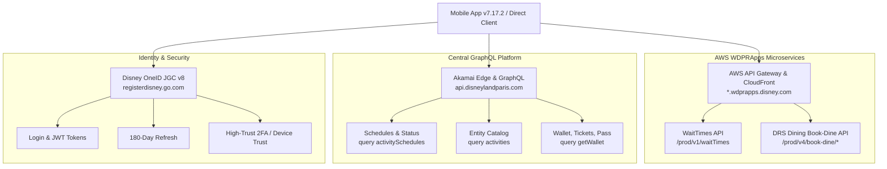

[🇫🇷 Français](README.md) | [🇬🇧 English](README.en.md) | [🇪🇸 Español](README.es.md)

> 🌐 *Translation of [`README.md`](README.md) (French is the source of truth) — last synced: 2026-11-27.*

# 🏰 Disneyland Paris — Reverse Engineering & API Documentation (v7.17.2)

[](https://api.disneylandparis.com)
[-purple.svg)](../../releases)
[](https://reactnative.dev)
[](https://python.org)
[](https://registerdisney.go.com)

Full technical specification, reverse engineering, and direct integration for the official **Disneyland Paris** mobile app APIs (**`fr.disneylandparis.android`, v7.17.2, `versionCode 1017172292`, `minSdkVersion 29` / Android 10+**).

> 📦 **Decompiled Source & Archives:**
> * **v7.17.2 (latest)**: The full decompiled package is available in [**GitHub Releases**](../../releases).
> * **v7.16 (previous)**: Archived on the [`archive/v7.16`](../../tree/archive/v7.16) branch and [`V7.16-archive`](../../releases/tag/V7.16-archive) tag.

> ℹ️ The full specification ([`DISNEYLAND_PARIS_API_SPEC.md`](./DISNEYLAND_PARIS_API_SPEC.md)) is written in French.

---

## 📑 Table of Contents
1. [What's New in v7.16 → v7.17.2](#-whats-new-in-v716--v7172)
2. [Installation](#-installation)
3. [API Architecture & Mapping](#-api-architecture--mapping)
4. [Essential JSON Schemas](#-essential-json-schemas)
5. [Disney OneID Auth & Device Trust](#-disney-oneid-auth--device-trust)
6. [Included CLI Tools](#-included-cli-tools)
7. [Quick Start (Python)](#-quick-start-python)
8. [Common Errors](#-common-errors)
9. [Repository Structure](#-repository-structure)

---

## 🆕 What's New in v7.16 → v7.17.2

* **Android & Build**: Switched to **Split APKs** packaging, `minSdkVersion` raised to **29 (Android 10+)**, `targetSdkVersion: 36`.
* **GraphQL (`api.disneylandparis.com/query`)**:
  * `query activities`: added `medias { type media { url } }`.
  * `query page`: added `borderColor` in `StandardGlobal.keyReasons`.
* **Pass & Reservations**: Added `AP_RESERVATIONS_QUERY_KEY` (*Disneyland Pass*); removed `getMagicPassSummaryQuery`, `FEATURE_TICKET_LINKING` and `RNPassKitHelper`.
* **Maps**: `tilesConfig714.json` → `tilesConfig717.json` (+2,307 zoom-17 tiles), added `ORION_PREMIER_ACCESS_ICON` / `REFURBISHMENT_POI_ICON`.
* **Security & Stack**: PII masking (`********`) in logs for `/bookings/`, `/orders/`, `/pass/`, `/payment/`, `/reservations/`, `/ticket/`, `/unlink/`. Migration to `ExpoNetwork`, `ExpoLinearGradient` and Android Edge-to-Edge.

➡️ Full diff and version history: [**`CHANGELOG.md`**](./CHANGELOG.md).

---

## 📦 Installation

**Requirements**: Python 3.10+, and Microsoft Edge installed for `auth_manager.py login` (the browser is launched through Playwright with `channel="msedge"`).

```bash
git clone https://github.com/0x3fx22/disneyland-paris-app.git
cd disneyland-paris-app
pip install -r requirements.txt
cp .env.example .env          # then fill in DISNEY_EMAIL / DISNEY_PASSWORD (and IMAP_* for automatic OTP)
python auth_manager.py login  # first login: creates authenticated_session.json and .disney_browser_profile/
```

> Public endpoints (WaitTimes, GraphQL schedules/catalog) require **no account**: only DRS and the profile need `login`.

---

## 🛰 API Architecture & Mapping



### Key Official Endpoints
Full index with last-verified dates: [spec §2.0](./DISNEYLAND_PARIS_API_SPEC.md#20-index-des-endpoints).

> 🧪 **Explore the API without writing code**:
> * [`openapi.yaml`](./openapi.yaml): OpenAPI 3.1 contract (paste into [Swagger Editor](https://editor.swagger.io) or run `npx @redocly/cli preview-docs openapi.yaml`).
> * [`requests/public.http`](./requests/public.http): ready-to-run requests (VS Code *REST Client* extension or JetBrains HTTP Client). [`requests/authenticated.http`](./requests/authenticated.http) for DRS and OneID.
> * [`queries/`](./queries): GraphQL `.graphql` queries and their `.variables.json`.
> * `python tools/verify_endpoints.py`: checks that public endpoints still respond as documented.

| Service | Protocol | Endpoint | Required Auth |
| :--- | :--- | :--- | :--- |
| **Wait Times (`waitTimes`)** | REST / JSON | `https://dlp-wt.wdprapps.disney.com/prod/v1/waitTimes` | Static `x-api-key` |
| **Schedules & Catalog** | GraphQL | `https://api.disneylandparis.com/query` | `x-application-id: mobile-app` |
| **Dining Dates (`availableDates`)** | REST / JSON | `https://dlp-is-sales-drs-book-dine.wdprapps.disney.com/prod/v4/book-dine/availableDates/{market}` | `x-api-key` + High-Trust Bearer |
| **Table Slots (`availabilities`)** | REST / JSON | `https://dlp-is-sales-drs-book-dine.wdprapps.disney.com/prod/v4/book-dine/availabilities/{market}` | `x-api-key` + High-Trust Bearer |
| **Guest Bookings (`retrieve`)** | REST / JSON | `https://dlp-is-sales-drs-book-dine.wdprapps.disney.com/prod/v4/book-dine/retrieve/{market}` | `x-api-key` + High-Trust Bearer |
| **Private Profile (`guest`)** | REST / JSON | `https://registerdisney.go.com/jgc/v8/client/TPR-DLP.WEB-PROD/guest/{swid}` | Standard Bearer |
| **Refresh Token (`refresh-auth`)** | REST / JSON | `https://registerdisney.go.com/jgc/v8/client/TPR-DLP.WEB-PROD/guest/refresh-auth` | `refreshToken` (180 days) |

---

## 📊 Essential JSON Schemas

Summary of the most-used fields. Full schemas, TypeScript types and Pydantic models: [spec §5](./DISNEYLAND_PARIS_API_SPEC.md#5-contrats-de-données--modèles-de-types-typescript--pydantic).

### 1. Session File (`authenticated_session.json`)
Stores the authentication state, tokens and cookies used for private requests:
* **`cookies`**: Session cookies (`SWID`, `TPR-DLP.WEB-PROD.api`, etc.).
* **`token.access_token`**: Bearer token (valid 24h) for `Authorization: Bearer <access_token>`.
* **`token.refresh_token`**: Long-lived token (**180 days**, `refresh_ttl: 15552000`) to renew `access_token` without a password.
* **`token.high_trust_expires_in`**: **High-Trust** validity (**30 minutes / 1799s**) required by DRS (`AUTHZ_GUEST_SECURED_SESSION`). After that, DRS returns `403 FORBIDDEN_SCOPE`.

### 2. DRS Table Reservations (`slotList`)
Returned by `POST /prod/v4/book-dine/availabilities/{market}?scope=Restaurant`:
* **`restaurantId`**: Technical ID (e.g. `P1AR00` = Captain Jack's, `P2TR02` = Bistrot Chez Rémy, `P1AR06` = Agrabah Café).
* **`mealPeriods`**: Split by service (`Lunch`, `Dinner`), each containing a `slotList` in 15-minute steps (`time` in AM/PM, `available`: **string** `"true"` / `"false"`, not a boolean). Details: [spec §2.3.2](./DISNEYLAND_PARIS_API_SPEC.md#232-créneaux-de-réservation-availabilities).

### 3. GraphQL Schedules & Status (`activitySchedules`)
Returned by `POST https://api.disneylandparis.com/query` (no token):
* `OPERATING` (`closed: false`), `REFURBISHMENT` (`closed: true`), `CLOSED`.

### 4. Live Wait Times (`waitTimes`)
Returned by `GET https://dlp-wt.wdprapps.disney.com/prod/v1/waitTimes`:
* Contains `id`, `name`, `parkId`, `status`, `postedWaitMinutes`, `singleRider`, `standby`, `virtualQueue`, `premierAccess` (availability + dynamic price) and `lastUpdated`.

---

## 🔐 Disney OneID Auth & Device Trust

1. **Tier 1 — Silent Refresh (~200 ms)**: `POST .../guest/refresh-auth` using the `refresh_token` (180 days).
2. **Tier 2 — Persistent Playwright Profile (Device Trust)**: `.disney_browser_profile/` keeps the verified-device cookies (`OneID_device`), allowing the session to be re-elevated to High-Trust **without asking for a new OTP**.
3. **Tier 3 — OTP Resolution & Anti-Flag**: Automatic IMAP support, timed human-like typing and a cooldown lock (`rate_limit_until`) when Disney rate-limits.

---

## 🛠 Included CLI Tools

### 1. [`auth_manager.py`](./auth_manager.py)
```bash
python auth_manager.py status                  # Token state and remaining High-Trust time
python auth_manager.py login                   # Persistent browser login (Device Trust / OTP)
python auth_manager.py refresh                 # Silent refresh (< 200 ms)
python auth_manager.py profile                 # Fetch the guest profile via /guest/{swid}
python auth_manager.py daemon --interval 1800  # Session keep-alive daemon
```

### 2. [`dining_scanner.py`](./dining_scanner.py)
```bash
python dining_scanner.py 2026-11-27 --popular           # Popular restaurant hours (no token)
python dining_scanner.py 2026-11-27 -r P1AR00           # Hours for a specific restaurant
python dining_scanner.py -r P1AR00 --dates              # Open dates on the DRS calendar (62 days)
python dining_scanner.py 2026-11-27 -r P1AR00 --drs -c 2 # Live DRS table slots
python dining_scanner.py --bookings                     # Active bookings of the logged-in account
python dining_scanner.py --restricted                   # Disney-hotel-only restaurants
```

---

## 🚀 Quick Start (Python)

```python
import httpx

url = "https://dlp-wt.wdprapps.disney.com/prod/v1/waitTimes"
headers = {
    "x-api-key": "3jPT5qMimN3kR2kxqd1ez9iF1C68CrBf7zw5ICo4",
    "User-Agent": "okhttp/4.12.0",
}
for ride in httpx.get(url, headers=headers).json()[:5]:
    print(f"{ride['name']}: {ride.get('postedWaitMinutes', 0)} min")
```

---

## 🩺 Common Errors

| Symptom | Likely Cause | Fix |
| :--- | :--- | :--- |
| `403 {"message":"Forbidden"}` | Missing or wrong `x-api-key` | Check the service-specific key (WaitTimes ≠ DRS) |
| `403 FORBIDDEN_SCOPE` (DRS) | 30-min High-Trust window expired | `python auth_manager.py login` |
| `401 Unauthorized` | `access_token` expired (24h) | `python auth_manager.py refresh` |
| `PALOMINO_CHECK_FAILED` | Wrong password or Disney rate-limiting | Wait for the cooldown to end (`python auth_manager.py status`) |

Full list: [spec §3.1](./DISNEYLAND_PARIS_API_SPEC.md#31-codes-derreur--résolution).

---

## 📂 Repository Structure

* [**`DISNEYLAND_PARIS_API_SPEC.md`**](./DISNEYLAND_PARIS_API_SPEC.md): Full technical specification (GraphQL, WaitTimes, DRS, OneID, error codes).
* [**`CHANGELOG.md`**](./CHANGELOG.md): Differences between analyzed app versions.
* [**`requirements.txt`**](./requirements.txt) & [**`.env.example`**](./.env.example): Python dependencies and configuration template.
* [**`openapi.yaml`**](./openapi.yaml): OpenAPI 3.1 contract for the REST and GraphQL endpoints.
* [**`queries/`**](./queries): Ready-to-use GraphQL queries and variables.
* [**`requests/`**](./requests): Runnable request collection (`.http`).
* [**`tools/verify_endpoints.py`**](./tools/verify_endpoints.py): Automatic check of public endpoints (run weekly by GitHub Actions).
* [**`auth_manager.py`**](./auth_manager.py) & [**`dining_scanner.py`**](./dining_scanner.py): Ready-to-use CLI tools.
* [**`assets/`**](./assets): Extracted configuration files (`app.config` v7.17.2).
* [**`app/`**](./app): Reference decompiled tree (the full decompiled v7.17.2 build is published in [**GitHub Releases**](../../releases)).

---

## ⚖️ Disclaimer
Educational technical & interoperability research only. All trademarks belong to **The Walt Disney Company** and **Euro Disney Associés S.C.A.**.
