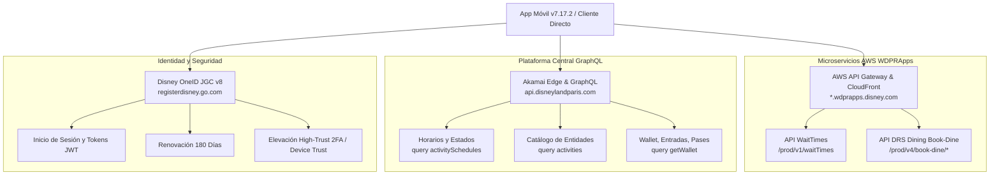

[🇫🇷 Français](README.md) | [🇬🇧 English](README.en.md) | [🇪🇸 Español](README.es.md)

> 🌐 *Traducción de [`README.md`](README.md) (el francés es la versión de referencia) — última sincronización: 2026-11-27.*

# 🏰 Disneyland Paris — Ingeniería Inversa y Documentación API (v7.17.2)

[](https://api.disneylandparis.com)
[-purple.svg)](../../releases)
[](https://reactnative.dev)
[](https://python.org)
[](https://registerdisney.go.com)

Especificación técnica completa, ingeniería inversa e integración directa con las APIs oficiales de la aplicación móvil **Disneyland Paris (`fr.disneylandparis.android`, v7.17.2, `versionCode 1017172292`, `minSdkVersion 29` / Android 10+)**.

> 📦 **Código fuente descompilado y archivos:**
> * **v7.17.2 (última versión)**: El paquete descompilado completo está disponible en [**GitHub Releases**](../../releases).
> * **v7.16 (versión anterior)**: Archivada en la rama [`archive/v7.16`](../../tree/archive/v7.16) y la etiqueta [`V7.16-archive`](../../releases/tag/V7.16-archive).

> ℹ️ La especificación completa ([`DISNEYLAND_PARIS_API_SPEC.md`](./DISNEYLAND_PARIS_API_SPEC.md)) está redactada en francés.

---

## 📑 Índice
1. [Novedades v7.16 → v7.17.2](#-novedades-v716--v7172)
2. [Instalación](#-instalación)
3. [Arquitectura y Mapa de APIs](#-arquitectura-y-mapa-de-apis)
4. [Esquemas JSON Esenciales](#-esquemas-json-esenciales)
5. [Autenticación Disney OneID y Device Trust](#-autenticación-disney-oneid-y-device-trust)
6. [Herramientas CLI Incluidas](#-herramientas-cli-incluidas)
7. [Inicio Rápido (Python)](#-inicio-rápido-python)
8. [Errores Frecuentes](#-errores-frecuentes)
9. [Estructura del Repositorio](#-estructura-del-repositorio)

---

## 🆕 Novedades v7.16 → v7.17.2

* **Android y Build**: Paso al empaquetado **Split APKs**, `minSdkVersion` elevado a **29 (Android 10+)** y `targetSdkVersion: 36`.
* **GraphQL (`api.disneylandparis.com/query`)**:
  * `query activities`: se añade `medias { type media { url } }`.
  * `query page`: se añade `borderColor` en `StandardGlobal.keyReasons`.
* **Pases y Reservas**: Se añade `AP_RESERVATIONS_QUERY_KEY` (*Disneyland Pass*); se eliminan `getMagicPassSummaryQuery`, `FEATURE_TICKET_LINKING` y `RNPassKitHelper`.
* **Mapas**: `tilesConfig714.json` → `tilesConfig717.json` (+2307 teselas de zoom 17) y se añaden `ORION_PREMIER_ACCESS_ICON` / `REFURBISHMENT_POI_ICON`.
* **Seguridad y Stack**: Enmascaramiento de datos personales (`********`) en los logs de `/bookings/`, `/orders/`, `/pass/`, `/payment/`, `/reservations/`, `/ticket/`, `/unlink/`. Migración a `ExpoNetwork`, `ExpoLinearGradient` y Android Edge-to-Edge.

➡️ Diff completo e historial de versiones: [**`CHANGELOG.md`**](./CHANGELOG.md).

---

## 📦 Instalación

**Requisitos**: Python 3.10+ y Microsoft Edge instalado para `auth_manager.py login` (el navegador se lanza con Playwright usando `channel="msedge"`).

```bash
git clone https://github.com/0x3fx22/disneyland-paris-app.git
cd disneyland-paris-app
pip install -r requirements.txt
cp .env.example .env          # después rellenar DISNEY_EMAIL / DISNEY_PASSWORD (e IMAP_* para el OTP automático)
python auth_manager.py login  # primer inicio de sesión: crea authenticated_session.json y .disney_browser_profile/
```

> Los endpoints públicos (WaitTimes, GraphQL de horarios/catálogo) **no requieren cuenta**: solo DRS y el perfil necesitan `login`.

---

## 🛰 Arquitectura y Mapa de APIs



### Endpoints Oficiales Clave
Índice completo con fecha de última verificación: [spec §2.0](./DISNEYLAND_PARIS_API_SPEC.md#20-index-des-endpoints).

> 🧪 **Explorar la API sin escribir código**:
> * [`openapi.yaml`](./openapi.yaml): contrato OpenAPI 3.1 (pegar en [Swagger Editor](https://editor.swagger.io) o `npx @redocly/cli preview-docs openapi.yaml`).
> * [`requests/public.http`](./requests/public.http): peticiones listas para ejecutar (extensión VS Code *REST Client* o JetBrains HTTP Client). [`requests/authenticated.http`](./requests/authenticated.http) para DRS y OneID.
> * [`queries/`](./queries): consultas GraphQL `.graphql` y sus `.variables.json`.
> * `python tools/verify_endpoints.py`: comprueba que los endpoints públicos siguen respondiendo como está documentado.

| Servicio | Protocolo | Endpoint | Autenticación Requerida |
| :--- | :--- | :--- | :--- |
| **Tiempos de Espera (`waitTimes`)** | REST / JSON | `https://dlp-wt.wdprapps.disney.com/prod/v1/waitTimes` | `x-api-key` estática |
| **Horarios y Catálogo** | GraphQL | `https://api.disneylandparis.com/query` | `x-application-id: mobile-app` |
| **Fechas de Restaurante (`availableDates`)** | REST / JSON | `https://dlp-is-sales-drs-book-dine.wdprapps.disney.com/prod/v4/book-dine/availableDates/{market}` | `x-api-key` + Bearer High-Trust |
| **Franjas de Mesa (`availabilities`)** | REST / JSON | `https://dlp-is-sales-drs-book-dine.wdprapps.disney.com/prod/v4/book-dine/availabilities/{market}` | `x-api-key` + Bearer High-Trust |
| **Reservas del Visitante (`retrieve`)** | REST / JSON | `https://dlp-is-sales-drs-book-dine.wdprapps.disney.com/prod/v4/book-dine/retrieve/{market}` | `x-api-key` + Bearer High-Trust |
| **Perfil Privado (`guest`)** | REST / JSON | `https://registerdisney.go.com/jgc/v8/client/TPR-DLP.WEB-PROD/guest/{swid}` | Bearer Estándar |
| **Refresh Token (`refresh-auth`)** | REST / JSON | `https://registerdisney.go.com/jgc/v8/client/TPR-DLP.WEB-PROD/guest/refresh-auth` | `refreshToken` (180 días) |

---

## 📊 Esquemas JSON Esenciales

Resumen de los campos más usados. Esquemas completos, tipos TypeScript y modelos Pydantic: [spec §5](./DISNEYLAND_PARIS_API_SPEC.md#5-contrats-de-données--modèles-de-types-typescript--pydantic).

### 1. Archivo de Sesión (`authenticated_session.json`)
Guarda el estado de autenticación, los tokens y las cookies para las peticiones privadas:
* **`cookies`**: Cookies de sesión (`SWID`, `TPR-DLP.WEB-PROD.api`, etc.).
* **`token.access_token`**: Token Bearer (válido 24 h) para `Authorization: Bearer <access_token>`.
* **`token.refresh_token`**: Token de larga duración (**180 días**, `refresh_ttl: 15552000`) para renovar `access_token` sin contraseña.
* **`token.high_trust_expires_in`**: Validez **High-Trust (30 minutos / 1799 s)** exigida por DRS (`AUTHZ_GUEST_SECURED_SESSION`). Pasado ese tiempo, DRS devuelve `403 FORBIDDEN_SCOPE`.

### 2. Reservas de Mesa DRS (`slotList`)
Devuelto por `POST /prod/v4/book-dine/availabilities/{market}?scope=Restaurant`:
* **`restaurantId`**: ID técnico (p. ej. `P1AR00` = Captain Jack's, `P2TR02` = Bistrot Chez Rémy, `P1AR06` = Agrabah Café).
* **`mealPeriods`**: División por servicio (`Lunch`, `Dinner`) con `slotList` en franjas de 15 minutos (`time` en AM/PM, `available`: **cadena** `"true"` / `"false"`, no un booleano). Detalle: [spec §2.3.2](./DISNEYLAND_PARIS_API_SPEC.md#232-créneaux-de-réservation-availabilities).

### 3. Horarios y Estados GraphQL (`activitySchedules`)
Devuelto por `POST https://api.disneylandparis.com/query` (sin token):
* `OPERATING` (`closed: false`), `REFURBISHMENT` (`closed: true`), `CLOSED`.

### 4. Tiempos de Espera en Directo (`waitTimes`)
Devuelto por `GET https://dlp-wt.wdprapps.disney.com/prod/v1/waitTimes`:
* Contiene `id`, `name`, `parkId`, `status`, `postedWaitMinutes`, `singleRider`, `standby`, `virtualQueue`, `premierAccess` (disponibilidad + precio dinámico) y `lastUpdated`.

---

## 🔐 Autenticación Disney OneID y Device Trust

1. **Nivel 1 — Renovación Silenciosa (~200 ms)**: `POST .../guest/refresh-auth` con el `refresh_token` (180 días).
2. **Nivel 2 — Perfil Persistente de Playwright (Device Trust)**: `.disney_browser_profile/` conserva las cookies de dispositivo verificado (`OneID_device`), lo que permite volver a elevar la sesión a High-Trust **sin pedir un nuevo OTP**.
3. **Nivel 3 — Resolución de OTP y Anti-Flag**: Soporte IMAP automático, escritura temporizada de tipo humano y bloqueo de enfriamiento (`rate_limit_until`) cuando Disney limita las peticiones.

---

## 🛠 Herramientas CLI Incluidas

### 1. [`auth_manager.py`](./auth_manager.py)
```bash
python auth_manager.py status                  # Estado del token y tiempo High-Trust restante
python auth_manager.py login                   # Inicio de sesión con navegador persistente (Device Trust / OTP)
python auth_manager.py refresh                 # Renovación silenciosa (< 200 ms)
python auth_manager.py profile                 # Obtener el perfil del visitante vía /guest/{swid}
python auth_manager.py daemon --interval 1800  # Demonio de mantenimiento de sesión
```

### 2. [`dining_scanner.py`](./dining_scanner.py)
```bash
python dining_scanner.py 2026-11-27 --popular           # Horarios de los restaurantes populares (sin token)
python dining_scanner.py 2026-11-27 -r P1AR00           # Horarios de un restaurante concreto
python dining_scanner.py -r P1AR00 --dates              # Fechas abiertas en el calendario DRS (62 días)
python dining_scanner.py 2026-11-27 -r P1AR00 --drs -c 2 # Franjas de mesa DRS en directo
python dining_scanner.py --bookings                     # Reservas activas de la cuenta conectada
python dining_scanner.py --restricted                   # Restaurantes reservados a los hoteles Disney
```

---

## 🚀 Inicio Rápido (Python)

```python
import httpx

url = "https://dlp-wt.wdprapps.disney.com/prod/v1/waitTimes"
headers = {
    "x-api-key": "3jPT5qMimN3kR2kxqd1ez9iF1C68CrBf7zw5ICo4",
    "User-Agent": "okhttp/4.12.0",
}
for ride in httpx.get(url, headers=headers).json()[:5]:
    print(f"{ride['name']}: {ride.get('postedWaitMinutes', 0)} min")
```

---

## 🩺 Errores Frecuentes

| Síntoma | Causa probable | Solución |
| :--- | :--- | :--- |
| `403 {"message":"Forbidden"}` | `x-api-key` ausente o incorrecta | Comprobar la clave propia del servicio (WaitTimes ≠ DRS) |
| `403 FORBIDDEN_SCOPE` (DRS) | Ventana High-Trust de 30 min caducada | `python auth_manager.py login` |
| `401 Unauthorized` | `access_token` caducado (24 h) | `python auth_manager.py refresh` |
| `PALOMINO_CHECK_FAILED` | Contraseña incorrecta o limitación de Disney | Esperar a que termine el enfriamiento (`python auth_manager.py status`) |

Lista completa: [spec §3.1](./DISNEYLAND_PARIS_API_SPEC.md#31-codes-derreur--résolution).

---

## 📂 Estructura del Repositorio

* [**`DISNEYLAND_PARIS_API_SPEC.md`**](./DISNEYLAND_PARIS_API_SPEC.md): Especificación técnica completa (GraphQL, WaitTimes, DRS, OneID, códigos de error).
* [**`CHANGELOG.md`**](./CHANGELOG.md): Diferencias entre las versiones analizadas de la app.
* [**`requirements.txt`**](./requirements.txt) y [**`.env.example`**](./.env.example): Dependencias de Python y plantilla de configuración.
* [**`openapi.yaml`**](./openapi.yaml): Contrato OpenAPI 3.1 de los endpoints REST y GraphQL.
* [**`queries/`**](./queries): Consultas GraphQL y variables listas para usar.
* [**`requests/`**](./requests): Colección de peticiones ejecutables (`.http`).
* [**`tools/verify_endpoints.py`**](./tools/verify_endpoints.py): Verificación automática de los endpoints públicos (ejecutada cada semana por GitHub Actions).
* [**`auth_manager.py`**](./auth_manager.py) y [**`dining_scanner.py`**](./dining_scanner.py): Herramientas CLI listas para usar.
* [**`assets/`**](./assets): Archivos de configuración extraídos (`app.config` v7.17.2).
* [**`app/`**](./app): Árbol descompilado de referencia (la versión completa descompilada v7.17.2 está publicada en [**GitHub Releases**](../../releases)).

---

## ⚖️ Aviso Legal
Proyecto de estudio técnico e interoperabilidad con fines educativos. Todas las marcas mencionadas pertenecen a **The Walt Disney Company** y **Euro Disney Associés S.C.A.**.
