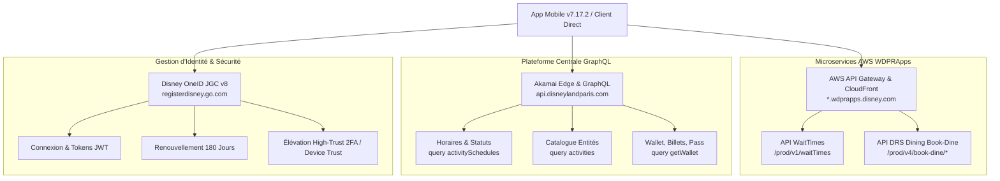

[🇫🇷 Français](README.md) | [🇬🇧 English](README.en.md) | [🇪🇸 Español](README.es.md)

# 🏰 Disneyland Paris — Reverse Engineering & API Documentation (v7.17.2)

[](https://api.disneylandparis.com)
[-purple.svg)](../../releases)
[](https://reactnative.dev)
[](https://python.org)
[](https://registerdisney.go.com)

Spécification technique complète, rétro-ingénierie et intégration directe des APIs officielles de l'application mobile **Disneyland Paris (`fr.disneylandparis.android`, v7.17.2, `versionCode 1017172292`, `minSdkVersion 29` / Android 10+)**.

> 📦 **Code source décompilé & Archives :**
> * **v7.17.2 (dernière version)** : L'archive complète décompilée est disponible dans [**GitHub Releases**](../../releases).
> * **v7.16 (version précédente)** : Archivée sur la branche [`archive/v7.16`](../../tree/archive/v7.16) et le tag [`V7.16-archive`](../../releases/tag/V7.16-archive).

---

## 📑 Table des Matières
1. [Nouveautés v7.16 → v7.17.2](#-nouveautés-v716--v7172)
2. [Installation](#-installation)
3. [Architecture & Cartographie des APIs](#-architecture--cartographie-des-apis)
4. [Schémas JSON Essentiels](#-schémas-json-essentiels)
5. [Authentification Disney OneID & Device Trust](#-authentification-disney-oneid--device-trust)
6. [Outils & Scripts Inclus](#-outils--scripts-inclus)
7. [Démarrage Rapide (Python)](#-démarrage-rapide-python)
8. [Erreurs Fréquentes](#-erreurs-fréquentes)
9. [Structure du Dépôt](#-structure-du-dépôt)

---

## 🆕 Nouveautés v7.16 → v7.17.2

* **Android & Build** : Passage au packaging **Split APKs**, `minSdkVersion` relevé à **29 (Android 10+)** et `targetSdkVersion: 36`.
* **GraphQL (`api.disneylandparis.com/query`)** :
  * `query activities` : ajout de `medias { type media { url } }`.
  * `query page` : ajout de `borderColor` dans `StandardGlobal.keyReasons`.
* **Pass & Réservations** : Ajout de `AP_RESERVATIONS_QUERY_KEY` (*Disneyland Pass*) ; retrait de `getMagicPassSummaryQuery`, `FEATURE_TICKET_LINKING` et `RNPassKitHelper`.
* **Cartographie** : Passage de `tilesConfig714.json` à `tilesConfig717.json` (+2 307 tuiles zoom 17) et ajout de `ORION_PREMIER_ACCESS_ICON` / `REFURBISHMENT_POI_ICON`.
* **Sécurité & Stack** : Masquage PII (`********`) dans les logs pour `/bookings/`, `/orders/`, `/pass/`, `/payment/`, `/reservations/`, `/ticket/`, `/unlink/`. Migration vers `ExpoNetwork`, `ExpoLinearGradient` et Android Edge-to-Edge.

➡️ Diff complet et historique des versions : [**`CHANGELOG.md`**](./CHANGELOG.md).

---

## 📦 Installation

**Prérequis** : Python 3.10+, et Microsoft Edge installé pour `auth_manager.py login` (le navigateur est lancé via Playwright avec `channel="msedge"`).

```bash
git clone https://github.com/0x3fx22/disneyland-paris-app.git
cd disneyland-paris-app
pip install -r requirements.txt
cp .env.example .env          # puis renseigner DISNEY_EMAIL / DISNEY_PASSWORD (et IMAP_* pour l'OTP automatique)
python auth_manager.py login  # première connexion : crée authenticated_session.json et .disney_browser_profile/
```

> Les endpoints publics (WaitTimes, GraphQL horaires/catalogue) ne nécessitent **aucun compte** : seuls DRS et le profil exigent `login`.

---

## 🛰 Architecture & Cartographie des APIs



### Endpoints Officiels Clés
Index complet avec date de dernière vérification : [spec §2.0](./DISNEYLAND_PARIS_API_SPEC.md#20-index-des-endpoints).

> 🧪 **Explorer l'API sans écrire de code** :
> * [`openapi.yaml`](./openapi.yaml) : contrat OpenAPI 3.1 (à coller dans [Swagger Editor](https://editor.swagger.io) ou `npx @redocly/cli preview-docs openapi.yaml`).
> * [`requests/public.http`](./requests/public.http) : requêtes prêtes à exécuter (extension VS Code *REST Client* ou JetBrains HTTP Client). [`requests/authenticated.http`](./requests/authenticated.http) pour DRS et OneID.
> * [`queries/`](./queries) : requêtes GraphQL `.graphql` et leurs variables `.variables.json`.
> * `python tools/verify_endpoints.py` : vérifie que les endpoints publics répondent toujours comme documenté.

| Service | Protocole | Endpoint | Authentification Requise |
| :--- | :--- | :--- | :--- |
| **Temps d'Attente (`waitTimes`)** | REST / JSON | `https://dlp-wt.wdprapps.disney.com/prod/v1/waitTimes` | `x-api-key` statique |
| **Horaires & Catalogue** | GraphQL | `https://api.disneylandparis.com/query` | `x-application-id: mobile-app` |
| **Dates Restaurant (`availableDates`)** | REST / JSON | `https://dlp-is-sales-drs-book-dine.wdprapps.disney.com/prod/v4/book-dine/availableDates/{market}` | `x-api-key` + Bearer High-Trust |
| **Créneaux Table (`availabilities`)** | REST / JSON | `https://dlp-is-sales-drs-book-dine.wdprapps.disney.com/prod/v4/book-dine/availabilities/{market}` | `x-api-key` + Bearer High-Trust |
| **Réservations Visiteur (`retrieve`)** | REST / JSON | `https://dlp-is-sales-drs-book-dine.wdprapps.disney.com/prod/v4/book-dine/retrieve/{market}` | `x-api-key` + Bearer High-Trust |
| **Profil Privé (`guest`)** | REST / JSON | `https://registerdisney.go.com/jgc/v8/client/TPR-DLP.WEB-PROD/guest/{swid}` | Bearer Standard |
| **Refresh Token (`refresh-auth`)** | REST / JSON | `https://registerdisney.go.com/jgc/v8/client/TPR-DLP.WEB-PROD/guest/refresh-auth` | `refreshToken` (180 jours) |

---

## 📊 Schémas JSON Essentiels

Résumé des champs les plus utilisés. Schémas complets, types TypeScript et modèles Pydantic : [spec §5](./DISNEYLAND_PARIS_API_SPEC.md#5-contrats-de-données--modèles-de-types-typescript--pydantic).

### 1. Fichier de Session (`authenticated_session.json`)
Conserve l'état d'authentification, les jetons et les cookies pour les requêtes privées :
* **`cookies`** : Cookies de session (`SWID`, `TPR-DLP.WEB-PROD.api`, etc.).
* **`token.access_token`** : Jeton Bearer (valide 24h) pour `Authorization: Bearer <access_token>`.
* **`token.refresh_token`** : Jeton longue durée (**180 jours**, `refresh_ttl: 15552000`) pour renouveler `access_token` sans mot de passe.
* **`token.high_trust_expires_in`** : Validité **High-Trust (30 minutes / 1799s)** requise par DRS (`AUTHZ_GUEST_SECURED_SESSION`). Au-delà, DRS renvoie `403 FORBIDDEN_SCOPE`.

### 2. Réservations de Tables DRS (`slotList`)
Renvoyé par `POST /prod/v4/book-dine/availabilities/{market}?scope=Restaurant` :
* **`restaurantId`** : ID technique (ex. `P1AR00` = Captain Jack's, `P2TR02` = Bistrot Chez Rémy, `P1AR06` = Agrabah Café).
* **`mealPeriods`** : Découpage par service (`Lunch`, `Dinner`) contenant `slotList` par tranches de 15 minutes (`time` en AM/PM, `available` : **chaîne** `"true"` / `"false"`, pas un booléen). Détail : [spec §2.3.2](./DISNEYLAND_PARIS_API_SPEC.md#232-créneaux-de-réservation-availabilities).

### 3. Horaires & Statuts GraphQL (`activitySchedules`)
Renvoyé par `POST https://api.disneylandparis.com/query` (sans jeton) :
* `OPERATING` (`closed: false`), `REFURBISHMENT` (`closed: true`), `CLOSED`.

### 4. Temps d'Attente Directs (`waitTimes`)
Renvoyé par `GET https://dlp-wt.wdprapps.disney.com/prod/v1/waitTimes` :
* Contient `id`, `name`, `parkId`, `status`, `postedWaitMinutes`, `singleRider`, `standby`, `virtualQueue`, `premierAccess` (disponibilité + tarif dynamique) et `lastUpdated`.

---

## 🔐 Authentification Disney OneID & Device Trust

1. **Tier 1 — Refresh Silencieux (~200 ms)** : `POST .../guest/refresh-auth` via `refresh_token` (180 jours).
2. **Tier 2 — Profil Persistant Playwright (Device Trust)** : `.disney_browser_profile/` conserve les cookies d'appareil vérifié (`OneID_device`), permettant de réélever la session en High-Trust **sans redemander d'OTP**.
3. **Tier 3 — Résolution OTP & Anti-Flag** : Support IMAP automatique, frappe humaine temporisée et verrouillage de refroidissement (`rate_limit_until`) en cas de limitation Disney.

---

## 🛠 Outils & Scripts Inclus

### 1. [`auth_manager.py`](./auth_manager.py)
```bash
python auth_manager.py status                  # État du jeton et durée High-Trust restante
python auth_manager.py login                   # Connexion navigateur persistante (Device Trust / OTP)
python auth_manager.py refresh                 # Rafraîchissement silencieux (< 200 ms)
python auth_manager.py profile                 # Récupérer le profil visiteur via /guest/{swid}
python auth_manager.py daemon --interval 1800  # Démon de maintien de session
```

### 2. [`dining_scanner.py`](./dining_scanner.py)
```bash
python dining_scanner.py 2026-11-27 --popular           # Horaires des restaurants populaires (sans jeton)
python dining_scanner.py 2026-11-27 -r P1AR00           # Horaires d'un restaurant précis
python dining_scanner.py -r P1AR00 --dates              # Dates ouvertes sur le calendrier DRS (62 jours)
python dining_scanner.py 2026-11-27 -r P1AR00 --drs -c 2 # Créneaux de table DRS en direct
python dining_scanner.py --bookings                     # Réservations actives du compte connecté
python dining_scanner.py --restricted                   # Restaurants réservés aux hôtels Disney
```

---

## 🚀 Démarrage Rapide (Python)

```python
import httpx

url = "https://dlp-wt.wdprapps.disney.com/prod/v1/waitTimes"
headers = {
    "x-api-key": "3jPT5qMimN3kR2kxqd1ez9iF1C68CrBf7zw5ICo4",
    "User-Agent": "okhttp/4.12.0",
}
for ride in httpx.get(url, headers=headers).json()[:5]:
    print(f"{ride['name']} : {ride.get('postedWaitMinutes', 0)} min")
```

---

## 🩺 Erreurs Fréquentes

| Symptôme | Cause probable | Solution |
| :--- | :--- | :--- |
| `403 {"message":"Forbidden"}` | `x-api-key` manquante ou incorrecte | Vérifier la clé propre au service (WaitTimes ≠ DRS) |
| `403 FORBIDDEN_SCOPE` (DRS) | Fenêtre High-Trust de 30 min expirée | `python auth_manager.py login` |
| `401 Unauthorized` | `access_token` expiré (24 h) | `python auth_manager.py refresh` |
| `PALOMINO_CHECK_FAILED` | Mot de passe incorrect ou limitation Disney | Attendre la fin du cooldown (`python auth_manager.py status`) |

Liste complète : [spec §3.1](./DISNEYLAND_PARIS_API_SPEC.md#31-codes-derreur--résolution).

---

## 📂 Structure du Dépôt

* [**`DISNEYLAND_PARIS_API_SPEC.md`**](./DISNEYLAND_PARIS_API_SPEC.md) : Spécification technique complète (GraphQL, WaitTimes, DRS, OneID, codes d'erreur).
* [**`CHANGELOG.md`**](./CHANGELOG.md) : Différences entre versions de l'application analysées.
* [**`requirements.txt`**](./requirements.txt) & [**`.env.example`**](./.env.example) : Dépendances Python et modèle de configuration.
* [**`openapi.yaml`**](./openapi.yaml) : Contrat OpenAPI 3.1 des endpoints REST et GraphQL.
* [**`queries/`**](./queries) : Requêtes GraphQL et variables prêtes à l'emploi.
* [**`requests/`**](./requests) : Collection de requêtes exécutables (`.http`).
* [**`tools/verify_endpoints.py`**](./tools/verify_endpoints.py) : Vérification automatique des endpoints publics (lancée chaque semaine par GitHub Actions).
* [**`auth_manager.py`**](./auth_manager.py) & [**`dining_scanner.py`**](./dining_scanner.py) : Outils CLI prêts à l'emploi.
* [**`assets/`**](./assets) : Fichiers de configuration extraits (`app.config` v7.17.2).
* [**`app/`**](./app) : Arborescence décompilée de référence (la version complète décompilée v7.17.2 est publiée dans [**GitHub Releases**](../../releases)).

---

## ⚖️ Clause de Non-Responsabilité
Projet d'étude technique et d'interopérabilité à but éducatif. Toutes les marques mentionnées appartiennent à **The Walt Disney Company** et **Euro Disney Associés S.C.A.**.
